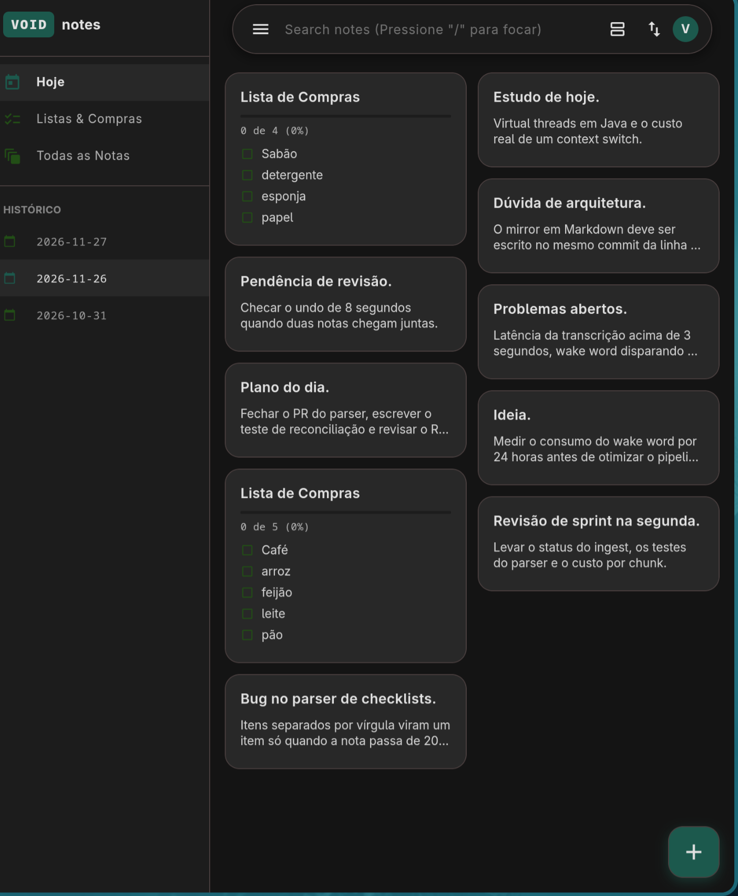

# void-notes

Hands-free voice notes on Linux: say **"Void"** or **"Hey Void"**, speak, and the thought is transcribed
offline and saved as a timestamped note in SQLite and in a daily Markdown file.




## Status

| Part | State |
|---|---|
| Wake word (`sherpa-onnx` Zipformer int8, 3.3M params) | works on Linux |
| Voice capture (`pw-record`, 16 kHz mono) | works on Linux |
| Transcription (`whisper.cpp` CLI, `base-q5_1` / `small-q5_1`, pt-BR) | works on Linux |
| Note storage (SQLite WAL) + Markdown mirror | works, 50 Rust tests |
| Desktop app (Flutter + GTK) | builds and runs on Linux |
| Android / iOS | **not implemented** — no `android/` or `ios/` target exists yet |
| In-process Rust wake word / STT | **not implemented** — traits and mocks only; today the real audio work is done by the daemon binaries |

This is an active project, not a finished product. Running it end to end currently means running the shell
daemon; the Flutter app browses the notes that daemon writes.

## How it works

```
microphone ──► sherpa-onnx keyword spotter ──► "Void" heard?
                                                     │
                              pw-record (16 kHz mono) ▼
                                        whisper.cpp CLI (pt, 2 threads)
                                                     │
                              DirectiveFormatter (strips wake word, drops
                              known silence hallucinations)
                                                     │
                        SQLite (notes.db, WAL) + notes/YYYY-MM-DD.md mirror
```

Every note is a `DirectiveNote`: client-generated UUID v4, immutable text, UTC timestamp. The Markdown
mirror is append-only and human-readable:

```markdown
- **[20:12:59]** Nota para o mercado, comprar salada, comprar café, comprar pasta de dente.
```

Design decisions live in `docs/adr/` (tiered acoustic pipeline, SQLite as source of truth with a Markdown
mirror, shared Rust core with Flutter UI, priority override with silent-meeting mode) and the domain language
in [`CONTEXT.md`](CONTEXT.md).

## Repository layout

| Path | Contents |
|---|---|
| `core/` | Rust engine: domain models, SQLite repository, Markdown mirror, energy gate, endpointing, ring buffer, STT formatter, wake-word and recognizer traits |
| `apps/mobile_desktop/` | Flutter app (Linux desktop today) talking to the core over `flutter_rust_bridge` v2 |
| `bin/`, `models/` | third-party binaries and model weights (gitignored; see Setup) |
| `listen_daemon.sh`, `kws_listener.py`, `listen_custom_void.py` | continuous wake-word daemon |
| `diagnose_mic.sh`, `record_test.sh`, `record_samples.py`, `train_custom_void.py` | microphone diagnosis, capture tests, wake-word sample collection and training |

## Setup

Prerequisites: Rust toolchain, Flutter (Linux desktop enabled), PipeWire (`pw-record`), and the model files —
none of the binaries or weights are committed, by design.

```bash
# 1. binaries used by the daemon
ls bin/   # whisper-cli, sherpa-onnx-keyword-spotter-microphone, sherpa-libs/

# 2. models
ls models/ggml-base-q5_1.bin models/ggml-small-q5_1.bin
ls models/sherpa-kws/   # encoder/decoder/joiner int8 + tokens.txt + keywords.txt

# 3. build and test the core
cargo test

# 4. run the daemon (Ctrl+C stops it)
./listen_daemon.sh            # small model
./listen_daemon.sh base       # faster, less accurate

# 5. or run the desktop app over the notes the daemon wrote
./run_app.sh
```

`models/sherpa-kws/keywords.txt` and `tokens.txt` are the only model files in git — the rest are downloaded
or trained locally (`train_custom_void.py` builds a custom wake-word model from samples collected with
`record_samples.py`).

## Tests

```bash
cargo test                     # 50 tests: unit, integration and regression
cd apps/mobile_desktop && flutter test
```

The regression suite exists because each of these actually happened: ghost notes written without speech
(`regression_anti_ghost_note.rs`), duplicated text from a hesitation pause (`regression_adaptive_hesitation.rs`),
silent-meeting mode leaking sound (`regression_silent_meeting.rs`) and the undo window not expiring
(`regression_undo_window.rs`).

## Known limitations

- **Linux only.** The Flutter project has no Android or iOS target yet; the README used to promise them, the
  repository does not have them.
- **Transcription quality varies.** Short captures with background audio still produce repeated phrases; the
  formatter strips the common hallucinations but cannot fix a bad capture.
- **Model files are not shipped.** A fresh clone does not run until `bin/` and `models/` are populated.
- **The daemon is the real product path.** The Rust core owns the domain and persistence; wake word and STT
  still shell out to `sherpa-onnx` and `whisper-cli`.

## License

MIT, as declared in `core/Cargo.toml`. A root `LICENSE` file is still missing.
